# Hermes Home Dashboard + Desktop

[](https://x.com/albertocvrrbs)

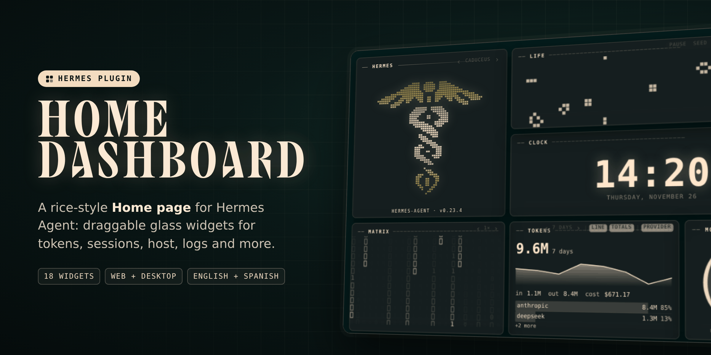

A customizable, *rice*-style **Home page** for the [Hermes Agent](https://github.com/NousResearch/hermes-agent) web dashboard and native Desktop app.

It adds a `Home` tab: a grid of glass widgets you can drag, resize, add and
remove. Each widget reveals **contextual controls on hover** (only outside edit
mode) — arrows, toggles, steppers — so the glass stays clean until you reach for
it. Your layout persists, and because the plugin lives under `~/.hermes/plugins/`,
it survives Hermes updates.

https://github.com/user-attachments/assets/10069980-bbb3-4d85-9e29-6069b643ce6b

---

## Install

### From the dashboard (recommended)

In the Hermes web dashboard, open the **Plugins** page → **Install from GitHub /
Git URL** and paste:

```
albertocvrrbs/hermes-home-dashboard
```

Leave **"Enable after install"** on, then click **Install**. Hermes clones the
repo into `~/.hermes/plugins/home-dashboard/`, discovers
`dashboard/manifest.json`, and the **Home** tab shows up. (If it doesn't appear,
hit **Re-scan** on the same page.)

No build step is needed — a prebuilt bundle (`dashboard/dist/`) ships in the repo.

### From the CLI

```bash
hermes plugins install albertocvrrbs/hermes-home-dashboard
```

### Hermes Desktop

Desktop has its own native plugin runtime, separate from the web dashboard.
Install the main plugin on the Hermes backend that Desktop connects to, then run
the included installer on the computer where Hermes Desktop runs. It links the
prebuilt bundle into `desktop-plugins/home-dashboard`; both locations live under
`HERMES_HOME`, so Hermes application updates do not remove them.

**Linux / macOS:**

```bash
hermes plugins install albertocvrrbs/hermes-home-dashboard --enable
node "${HERMES_HOME:-$HOME/.hermes}/plugins/home-dashboard/scripts/install-desktop.mjs"
```

**Windows PowerShell:**

```powershell
hermes plugins install albertocvrrbs/hermes-home-dashboard --enable
$HermesHome = if ($env:HERMES_HOME) { $env:HERMES_HOME } else { Join-Path $env:LOCALAPPDATA "hermes" }
node (Join-Path $HermesHome "plugins\home-dashboard\scripts\install-desktop.mjs")
```

Open Hermes Desktop. It detects the plugin automatically within a few seconds;
the fallback is **Ctrl/Cmd+K → Reload desktop plugins**. Home registers as a
full native page, adds a sidebar entry and command-palette action, and opens once
when each Desktop window starts. It can be enabled or disabled under
**Settings → Plugins**.

The link/junction points at the checked-out bundle, so `hermes plugins update
home-dashboard` updates both Web and Desktop without another copy step.

If a manually copied `home-dashboard` directory already exists, the installer
preserves it beside the new link as `home-dashboard.backup-<timestamp>`.

When Desktop connects to a remote Hermes backend, the split is intentional:
`desktop/plugin.js` runs on the personal computer, while the full plugin must be
installed and enabled on the remote backend so `/api/plugins/home-dashboard/*`
can serve layout, system, analytics, cron and session data. If the UI loads but
every widget says `no data` or `offline`, repair the remote side with:

```bash
hermes plugins install albertocvrrbs/hermes-home-dashboard --force --enable
```

Then restart or reconnect that backend and reload Desktop plugins.

### Update

Because the plugin is a normal git checkout, updates are a pull:

- **Dashboard:** the plugin's **Update** button (runs `git pull --ff-only`), then
  hard-refresh the `Home` tab (Ctrl+Shift+R).
- **CLI:** `hermes plugins update home-dashboard`.

The Desktop link/junction continues pointing at the updated bundle; no Desktop
reinstallation is required.

### Uninstall

Use the plugin's **Remove** button in the dashboard, or:

```bash
hermes plugins remove home-dashboard
```

### Troubleshooting: every widget says `offline` / `unavailable`

The UI half loads on its own, so a backend that never mounted looks like a data
problem. Check, on the machine running the Hermes backend:

1. `hermes plugins list` shows `home-dashboard` as **enabled**. Hermes only
   imports a user plugin's Python API when it is in `plugins.enabled` (and not
   in `plugins.disabled`) in `config.yaml`; `hermes plugins enable
   home-dashboard` fixes both.
2. `hermes plugins doctor home-dashboard` passes. Versions before 1.5.1 shipped
   no root `__init__.py`, which the loader refuses (`No __init__.py in ...`);
   update the plugin.
3. Restart the backend (or the Desktop connection) after enabling, then reload.

---

## The grid

- **Free 12-column grid.** Drag a widget anywhere.
- **Auto-swap.** Drop a widget on another of the same size and they trade places.
- **Live reflow.** Otherwise, the rest shift down in real time to open a slot.
- **Add / remove.** Drag from the catalog to add; drop on the tray to remove.
- **Resize** from the bottom-right corner. The layout autosaves and persists.

Toggle **edit mode** with the pencil button; hover controls hide while editing so
they never fight drag/resize.

## Widgets

19 widgets, each with a hover control that fits what it does:

| Widget | Hover control |
|---|---|
| **Clock** | toggle 12/24h and seconds |
| **Calendar** | page months · 3 responsive sizes |
| **Moon** | scrub the phase ±1 day |
| **Tokens** | switch range (7 days / 1 month / 6 months) · line ↔ bars chart · show/hide totals · group usage **all / by provider / by model** · hover a point for an animated tooltip |
| **Host** | cycle meters ↔ numeric detail ↔ live graphs (four rolling one-minute sparklines: cpu, ram, load, proc) |
| **Gateway** | hover expands read-only detail (pid, health, config) |
| **Spend** | switch range (today / 7 days / this month) · rank top sessions by **all costs / real spend** · step a monthly cap · click a session to open it |
| **Sessions** | paginate recent sessions · sort **recent / tokens** · minimum-token filter (all / ≥10K / ≥100K / ≥1M) |
| **Projects** | status board from `~/projects/<name>/status.json` · click a row for next action + alerts |
| **Board** | live preview of a board · cycle boards · click to open it (see [Board](#board)) |
| **Cron** | paginate upcoming jobs |
| **Logs** | switch log file: agent / errors / gateway (multi-line records grouped, level-colored) |
| **Notes** | quick to-dos · clear completed |
| **Pomodoro** | step work / break lengths |
| **Countdown** | alarm-style date+time picker (wheel, arrows, typing) |
| **Hermes** | cycle the emblem: the official banner caduceus, then kerykeion, talaria, petasos, lyre, tortoise, drachma and wing, dithered onto a square dot grid at the widget's size (see below) |
| **Matrix** | tune rain speed |
| **Heartbeat** | ECG trace · tune speed |
| **Life** | Conway's Game of Life — draw live cells, pause / seed / clear |

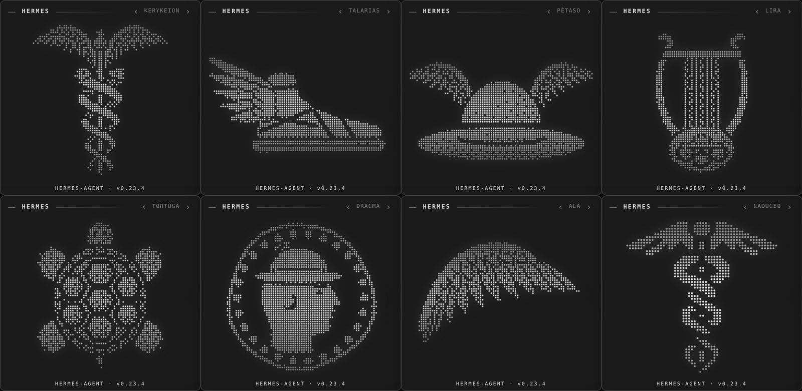

The **Hermes** widget paints real dots on a square grid instead of braille text
(a monospace cell is not 1:2, so braille art came out stretched). Each emblem is
drawn as vectors and Floyd–Steinberg dithered at the widget's resolution: grow
the widget and you get more dots, not fatter ones, crisp on HiDPI. The dots
resolve in when you switch designs and a faint glint passes now and then; both
stop under *reduce motion*, and nothing runs while the widget is idle.

State that should stick (ranges, formats, timer lengths, grouping, sort…) is
saved to the layout; transient state (current page, browsed month) resets on
reload.

### Tokens: group by provider or model

Hover the widget and click the last toggle (`all` → `provider` → `model`). Under
the chart you get one row per provider or model for the selected range, with its
tokens, share and (on hover) cost. Provider identity comes from the host's
per-model analytics (`/api/analytics/models`, the data behind the Models page);
on a Hermes without it, the widget falls back to the per-model list and says so.

### Spend: real money vs what your subscriptions cover

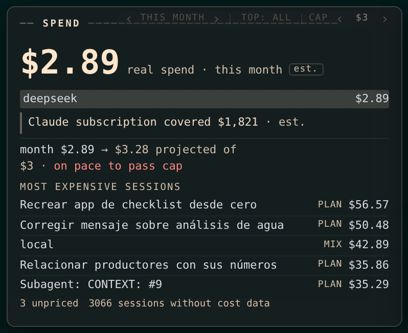

*Real data from a Hermes install on a Claude subscription plus DeepSeek API; the cap is set to $3 to show the warning state.*

The Tokens widget counts tokens; Spend counts dollars, and keeps two kinds of
dollars apart:

- **Real spend** (the headline) — pay-per-use money on API-key providers
  (DeepSeek, OpenRouter, OpenAI API, …), split by provider.
- **Covered by subscriptions** — what calls on a flat-fee plan would cost at
  API list prices, e.g. *"Claude subscription covered $1,821"*. You don't pay it
  per token, so it is never added to real spend.
- **Month line** — real spend this month and a straight-line month-end
  projection. Set a monthly cap from the hover stepper (saved with the layout):
  the line turns amber at 80% of the cap or when the projection passes it, and
  red once spend reaches it.
- **Most expensive sessions** in the range (all costs, or real spend only);
  click one to open it (chat resume on the web, the session on Desktop).
- `est.` marks amounts Hermes estimated from list prices rather than an
  invoice. Unclassified cost, unpriced sessions and sessions without cost data
  are counted in the footer instead of hidden.

How a cost is classified, per call (first match wins):

1. Hermes marked the route `included` (e.g. `openai-codex`) → subscription.
2. A flat-fee provider (`openai-codex`, Copilot) or a provider id containing
   `subscription` → subscription.
3. Anthropic with **only OAuth credentials** configured (a Claude Pro/Max
   login) → subscription. Hermes itself prices these calls as estimated API
   spend; this is the plugin's inference.
4. A provider with **only API keys** configured → real spend.
5. Anything else (mixed or removed credentials, unknown cost) →
   `unclassified`.

Limits: credentials are read as they are configured *now* (an old call made
with a since-removed API key follows today's setup) and from the active profile.
"Today" and "this month" follow your clock; like the host's own analytics, a
session's cost lands on the day it started.

Data comes from a read-only `/spend` route that opens `state.db` with
`mode=ro`, reads at most ~31 days and caps the rows. It uses the per-call usage
table, so a session that switched provider mid-way is split correctly (the
session row alone would bill all of it to the last provider). `?profile=<name>`
reads another profile's store.

### Sessions: sort and filter by tokens

Hover the widget: the first toggle switches `recent` ↔ `tokens` (heaviest
first), the second steps a minimum of input + output tokens. Both work over the
20 most recent sessions the Home already loads, and the token count shows on
each row while either is active.

### Projects: status board

The Projects widget lists every `~/projects/<name>/status.json` (set
`HOME_DASHBOARD_PROJECTS_DIR` to read another folder). No folder means an empty
board. Shape:

```json
{
  "project": "Wiki-Ingest",
  "status": "active",
  "lastUpdated": "2026-10-04T21:30:00+08:00",
  "stats": { "inbox": 2, "inProgress": 1, "completed": 15 },
  "alerts": [],
  "nextAction": "Process pending articles"
}
```

`status` colors the row: `active` / `healthy` / `online` / `ok`, `warning` /
`degraded`, `blocked` / `error` / `failed`; anything else is neutral. The backend
reads at most 50 projects, skips files over 64 KB, invalid JSON and symlinks that
leave the folder, and returns only the fields above. Contributed by
[@AgJavis-hub](https://github.com/AgJavis-hub) in #4.

## Languages

The UI ships in **English** and **Spanish**. It follows the host's language:
Hermes Desktop and the Webapp use `display.language`, the web dashboard uses its
own language picker; when the host exposes neither, the browser's language
decides. Anything not translated falls back to English, string by string. Dates
and month names follow your locale.

### Adding a language

One file. Copy `src/home/i18n/locales/en.ts` to
`src/home/i18n/locales/<id>.ts` (`<id>` = the language id Hermes uses, e.g. `fr`,
`de`, `pt-br`), translate the values and keep every key and `{placeholder}`:

```ts
import type { Messages } from "./en";

const fr: Messages = {
  "common.loading": "chargement…",
  // …every key from en.ts
};

export default fr;
```

The build picks it up automatically (no registration anywhere else). Run
`npm test`: it fails if a locale is missing a key, has an extra one, or drops a
placeholder. Rebuild (`npm run build`) and open a PR with the locale file and the
two regenerated bundles.

## Board

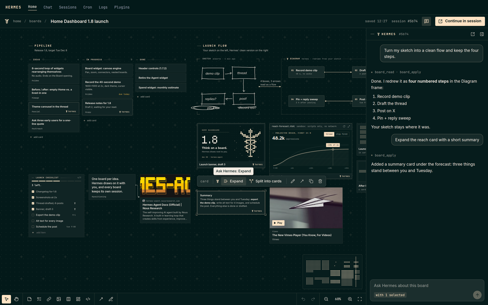

An infinite canvas for one idea per board, built like Milanote but in the
Home's own style: your host's UI font for text, the Home's mono for structure,
and the same lucide icons Hermes Desktop uses. You get cards, to-do lists,
columns, link and video cards, images, sandboxed HTML embeds, nested boards,
connectors and freehand sketches.

**Hermes works on it with you.** Ask in the chat panel on the right (`/`),
from the selection bar or the right-click menu ("Split into cards", "Turn
into a diagram"…), or in the board's session. His cursor walks over the board
as his edits land. A dot-matrix border and his caduceus signature mark what he
made; your work stays solid.

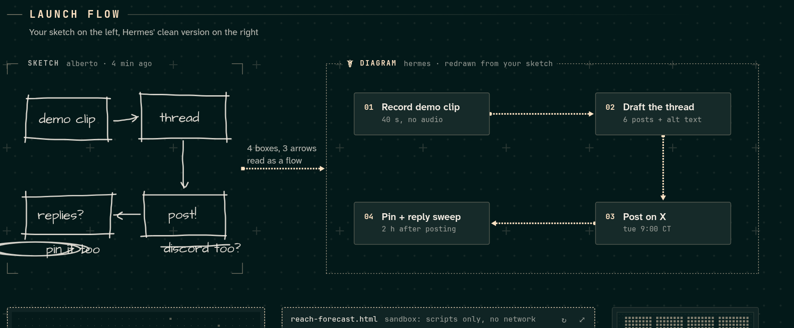

- **Paste anything.** A URL becomes a link card with title, description,
  favicon and image. A YouTube, Vimeo, Loom or X link, or a direct video file,
  becomes a playable card. An image, or an image URL, becomes an image card.
- **Videos without playing them.** Drop an MP4, WebM or MOV (up to 100 MB) on
  the board, or paste a link to one: the card shows a poster frame and the
  duration right away and only plays when you press play. Posters are made on
  the server with `ffmpeg` (a frame ~1 s in) and stored beside the board's
  assets; video cards made before 1.9.0 get theirs the first time they're
  shown, without editing the board. With no `ffmpeg`, the browser grabs the
  frame itself.
- **One session per board.** *Continue in session* (⌘↵ / Ctrl+↵) opens the
  session linked to the board. There, Hermes knows the board, and whatever you
  ask him gets drawn on it.
- **Chat panel.** A collapsible panel docked on the right shows the linked
  session's recent turns, your messages in the Desktop user bubble and Hermes'
  replies as plain text, with tool calls folded into one line. Toggle it with
  the header button or `/`, close it with `Esc`, drag its edge to resize; it
  remembers both. Selected items ride along with what you send.
  - *Hermes Desktop and the Webapp:* reads with the gateway's
    `session.transcript` (it never attaches the session to a pane) and sends
    with `prompt.submit`; the first message starts the board's session.
  - *Web dashboard:* reads the public `/api/sessions/{id}/messages` route. The
    web dashboard gives plugins no way to submit a turn, so sending copies
    your message and opens the session (the panel says so).
- **Model picker.** The panel header shows the model of the board's session.
  On Hermes Desktop and the Webapp it is Desktop's own model menu, the same
  component the chat composer opens (the SDK's `ModelCatalogMenu`), so search,
  provider groups, favourites, `-fast` variants, MoA presets, *Refresh models*
  and the per-model thinking/effort/speed submenu look and work the same. A
  pick switches only the board's session (`config.set model … --session`, the
  rule Desktop uses for a secondary chat tile), never your profile default; it
  sticks across reloads because the gateway saves it with the session, and
  expensive-model guards ask through Desktop's own confirm dialog. Desktop
  builds that don't export the menu show the model as text.
  - *Web dashboard:* the model is shown read-only (from the stored session);
    the web dashboard gives plugins no way to switch a session's model.

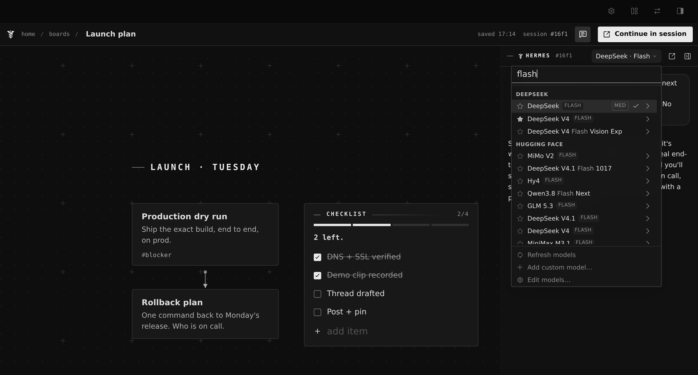

- **Draw.** `D` opens a small toolbar above the status bar: pen, highlighter
  (`⇧D`, translucent, always under the ink), eraser (`E` while drawing; strokes
  under it fade before they go) and lasso (loop around strokes, then drag,
  delete or group them with `⌘G`). Line, arrow, rectangle and ellipse take
  Shift for 45° / squares / circles and Alt to draw from the centre. Three
  widths (`[` `]`), six restrained colours (`1`–`6`: ink, accent, sage, clay,
  slate, sand), dashed, and smoothing (off / on / strong). Mouse strokes go
  through a speed-adaptive One Euro filter, so slow strokes lose their jitter
  and fast ones don't lag, and the live ink always reaches the pointer; on
  release the stroke is simplified and splined before it is saved. Pens keep
  their pressure. Hermes reads all of it: shapes, colours and highlights show
  up in his board outline and snapshots, so "Turn into a diagram" works on any
  selection of strokes.

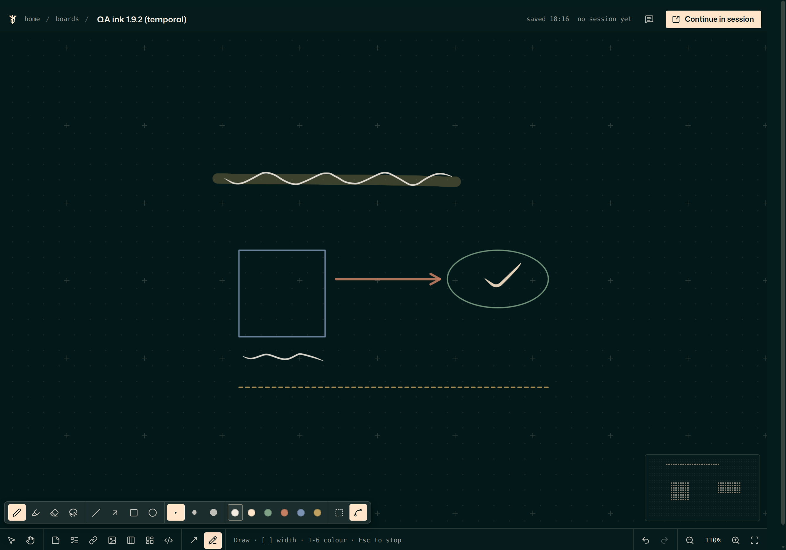

- **Tools and menus.** Every tool, action and menu row carries its lucide
  icon; the name and shortcut show in a tooltip after a short hover. Right-
  click a card for its actions, or the table to add something right there.
  The selection bar stays a fixed size at any zoom and never leaves the view.
- **Zoom and pan.** The mouse wheel zooms around the pointer, and so do
  Ctrl/⌘+wheel and a trackpad pinch. A two-finger trackpad scroll, Space+drag
  or a drag on the empty table pans; Shift+wheel pans sideways.
- **Keys:** `V` select · `H` pan · `N` note · `T` to-do · `C` column · `L` link ·
  `I` image · `B` board · `E` embed · `A` arrow · `D` draw · `/` chat · `F` fit ·
  `⌘Z` / `⌘⇧Z` undo / redo (Ctrl on Windows and Linux). While drawing: `D` pen ·
  `⇧D` highlighter · `E` eraser · `[` `]` width · `1`–`6` colour · `⌘G` group.

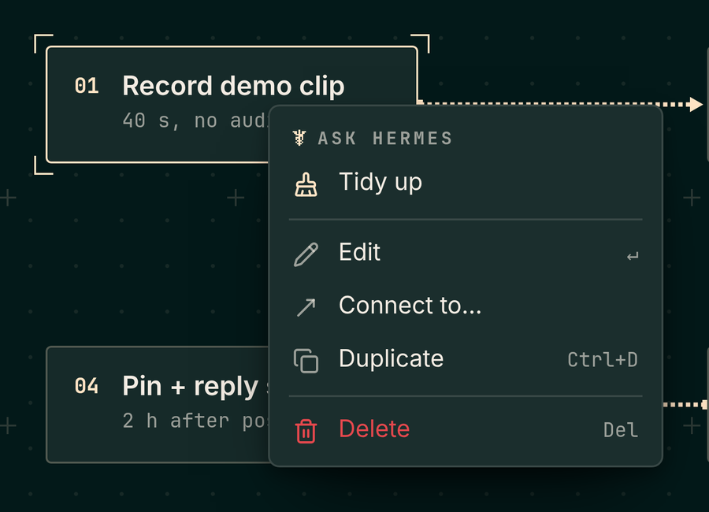
- **On the Home** the Board widget shows a live preview of a board; its hover
  controls cycle boards, create one or open the list. Click it to open the page. On Desktop, *Boards* is in the
  sidebar and the command palette.

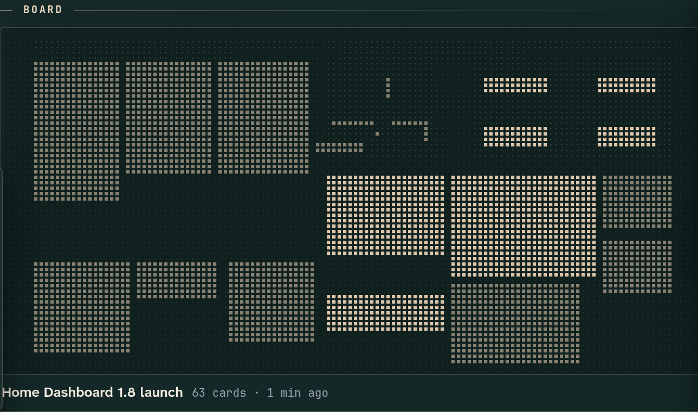

## Live cards

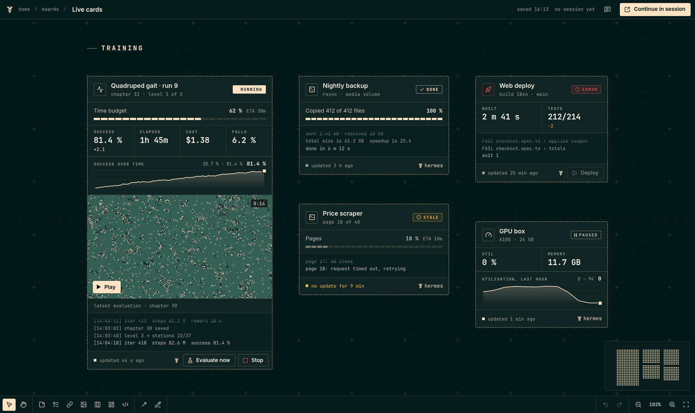

Cards that stay connected to something running: a training run, a backup, a scraper, a
deploy. Hermes creates one from a short declarative spec (header with status, progress with
ETA, metrics with deltas, a sparkline, an image or video with its poster, a log tail, and
buttons), then the agent or any script keeps it current by sending only **data**. The card
says how fresh that data is ("updated 12 s ago") and turns **stale** when a running job
stops reporting for longer than the card's TTL.

- **Made by Hermes, or by you.** `board_apply` takes a `live` item (`tpl: "training"`,
  `"job"` or `"stat"`, or your own `blocks`), and a `live` op that patches its data. Values
  are literals or `"$key"` reads from the data bag, so one spec serves the whole life of a job.
- **Fed by anything.** The agent's `live` op; a script on the same machine through the
  plugin's local store (no network, no token); or
  `POST /api/plugins/home-dashboard/boards/{board}/live/{card}/data` over HTTP, behind the
  dashboard's own auth. Data updates don't enter your undo history and Hermes doesn't read
  them as your edits.
- **Buttons that can only do what you allowed.** See the security model below.
- **Looks right at any width:** metrics reflow from four columns to pairs, narrow cards keep
  icon-only buttons, wide cards get a taller chart. Hermes-made cards wear his dot-matrix edge.

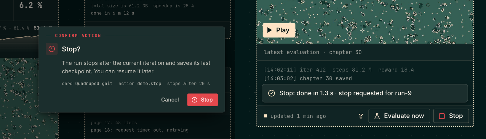

Full guide with curl and Python examples, the block reference, a sample action list, and a
complete adapter for a reinforcement-learning run folder (with a Stop button that ships
disabled): [`examples/README.md`](examples/README.md).

### Live card actions: security model

- **Allowlist only.** A button names an action **id**. The id has to exist in a JSON file
  the machine owner writes in `~/.hermes/plugin-data/home-dashboard/live-actions/` (or be
  registered in-process by Python code in the dashboard process). Cards, agents and HTML
  embeds can only point at ids; a card that tries to carry a `command`, `url` or `shell`
  field is rejected, and the agent sees ids and descriptions, never commands.
- **No shell.** Commands are argv lists with an absolute program path, run with
  `shell=False`, a minimal environment, stdin closed and a timeout (default 30 s, max 600).
  HTTP actions go only to the URL in the registry.
- **Checked arguments.** Each action declares its argument schema (`string` with a regex,
  `int`/`number` with bounds, `bool`, `enum`). Values come from the card, are validated on
  every press, and fill placeholders as whole text. The default string pattern refuses
  spaces, shell metacharacters and a leading dash.
- **Confirmation.** `destructive` actions open a confirm dialog (Cancel focused, Esc cancels)
  and the server refuses them without that confirmation. Disabled actions stay greyed out.
- **One at a time, all logged.** A running action can't be started twice. Every press,
  allowed or refused, goes to `live-actions.log.jsonl` with time, who (dashboard + client
  address), board, card, args, result, exit code, output tail and duration; the card shows the
  result in a toast.
- **Auth.** The action and data routes sit behind the same authentication as the rest of the
  dashboard. There is no separate per-card token.

### What the Board adds to your Hermes (disclosure)

- **Agent tools** (toolset `board`, enabled by default like other plugin
  toolsets; turn it off with `hermes tools`): `board_read`, `board_apply`,
  `board_render`. They read and write board files only; `board_read` can also
  list the ids and descriptions of the live card actions you registered. The
  agent cannot run an action.
- **A `pre_llm_call` hook.** It only acts on sessions linked to a board, which
  means sessions started from the board or containing its `[board:<id>]`
  marker. It adds a few lines saying what you changed on the board since
  Hermes' last turn. Every other session is left untouched.
- **File storage** under `~/.hermes/plugin-data/home-dashboard/boards/`. There
  is one JSON file per board, an append-only op log (compacted at 2000
  entries), `assets/` for images, videos and embedded HTML, and `posters/` for
  the video poster index. Deleted boards move to a trash folder there. Live
  card actions live in `../live-actions/*.json` (written by you, read by the
  plugin) and their log in `../live-actions.log.jsonl`.
- **Commands it can run:** only the live card actions you register (see
  [Live card actions: security model](#live-card-actions-security-model)), and
  `ffmpeg`/`ffprobe` (if installed) to read a video's length and grab its
  poster frame.
- **Network:** link previews are fetched **server-side by the plugin
  backend** when you paste or add a link: the page HTML, its oEmbed JSON, its
  image and favicon. The fetch is SSRF-guarded: http(s) only, private,
  loopback, link-local and metadata addresses blocked (re-checked after every
  redirect), at most 3 redirects, a 5 s deadline, size caps, and HTML only for
  metadata. Results are cached, and images are stored as assets so the board
  never hotlinks. For the poster of a video *link*, the backend downloads the
  video once with the same guard (public addresses only, 45 s, 80 MB cap)
  into a temporary file that is deleted after the frame is taken. Video players load from the provider (youtube-nocookie,
  player.vimeo, loom, platform.twitter) only when you press play. Embedded
  HTML runs in a sandboxed iframe with scripts only, no network and no
  same-origin.

## How it works

- Ships two self-contained React + Vite bundles: a **dashboard plugin**
  registered through `window.__HERMES_PLUGINS__`, and a native **Desktop
  runtime plugin** registered through `@hermes/plugin-sdk`.
- All data comes from the host's existing API (status, system, analytics,
  sessions, cron, logs) through one polling loop. A few widgets fetch on
  demand for their own controls — the Tokens range and grouping, the Logs file
  selector, the Projects board and Spend.
- The Python side (`dashboard/plugin_api.py`) persists the widget layout to
  `~/.hermes/plugins/home-dashboard/layout.json`, exposes plugin-scoped,
  read-only adapters for Desktop's widgets (`/system`, `/analytics`, `/models`,
  `/cron`, `/sessions`), reads the Projects board (`/projects`) and computes
  Spend (`/spend`, a read-only query on `state.db`). It also serves the Board
  (`/boards…`): board files, assets and link previews (the only network calls
  it makes, see [Board](#board)).
- UI strings go through a small translation layer (`src/home/i18n/`); see
  [Languages](#languages).
- Hover controls are pure CSS reveal (`:hover`), suppressed in edit mode — no
  per-widget hover state, which keeps the canvas widgets flicker-free.

## Repo layout

```
hermes-home-dashboard/
├── plugin.yaml              # pins the install folder name (home-dashboard)
├── __init__.py              # register(ctx): Board agent tools + pre_llm_call hook
├── dashboard/               # everything the Hermes host consumes
│   ├── manifest.json        # tab/entry/css/api the dashboard reads
│   ├── plugin_api.py        # layout.json + read-only data routes (+ /spend, /boards)
│   ├── boardkit/            # Board engine: ops, store, link previews, assets, agent,
│   │                        #   live cards (live.py), action allowlist (actions.py), posters
│   └── dist/                # prebuilt bundle (committed — installer doesn't build)
│       ├── index.js
│       └── style.css
├── desktop/
│   └── plugin.js            # prebuilt native Desktop runtime plugin
├── examples/                # live cards: push helper, action list, training-run adapter
├── src/                     # widget source (only needed to modify the plugin)
│   └── home/i18n/locales/   # one file per UI language (en.ts, es.ts)
├── vite.config.ts           # builds src/ → dashboard/dist/
├── vite.desktop.config.ts   # builds src/ → desktop/plugin.js
├── package.json
└── tsconfig.json
```

## Development

Only needed if you want to modify the widgets.

From a clone of this repository:

```bash
npm install
npm run typecheck     # tsc --noEmit
npm test              # Node tests + Python backend tests (needs python3)
npm run build         # Web bundle + Desktop plugin.js
```

`npm test` runs `test:frontend` (Node) and `test:backend` (Python `unittest`).
On Windows, if Python is installed as `py`, run `npm run test:frontend` and
`py -m unittest discover -s test -p "test_*.py"`.

Before a release, also exercise the real HTTP adapters with the Python of each
supported Hermes install. It uses a temporary `HERMES_HOME` (no user sessions or
config are read) and treats host compatibility warnings as errors:

```bash
/path/to/hermes-agent/venv/bin/python scripts/check-host-compatibility.py
```

Cross-directory imports in `src/` use the `@/` alias (`@/sdk` = `src/sdk.ts`),
configured in `tsconfig.json` and both Vite configs; prefer it over deep relative
chains.

Commit the regenerated `dashboard/dist/` and `desktop/plugin.js` so installs
pick up your changes (the installer clones, it never builds). To preview a web
build on a live install, copy `dashboard/dist/*` into
`~/.hermes/plugins/home-dashboard/dashboard/dist/` and hard-refresh the tab.
Desktop watches `desktop-plugins/home-dashboard/plugin.js` and hot-reloads it.

Add a new widget: create `src/home/widgets/MyWidget.tsx` and register it in
`src/home/widgets/registry.tsx`. Widgets receive `{ data, widgetProps,
onWidgetPropsChange, editing, gridSize }`; persist per-widget state with
`onWidgetPropsChange`, and use the shared `HoverArrows` / `HoverCtl` for the hover
control.

## Compatibility

- Web: requires a Hermes Agent install with the web dashboard.
- Desktop: requires a recent Hermes Desktop with the `desktop-plugins` runtime;
  verified against Hermes Agent v0.18.2.
- Uses supported plugin SDK doors and current host services, but Hermes is young
  — if a widget shows `no data`, that source may have changed upstream.

## Stay updated

Follow me on X for new versions of this plugin and other projects:

[](https://x.com/albertocvrrbs)

→ [x.com/albertocvrrbs](https://x.com/albertocvrrbs)

## License

MIT — see [LICENSE](LICENSE).
